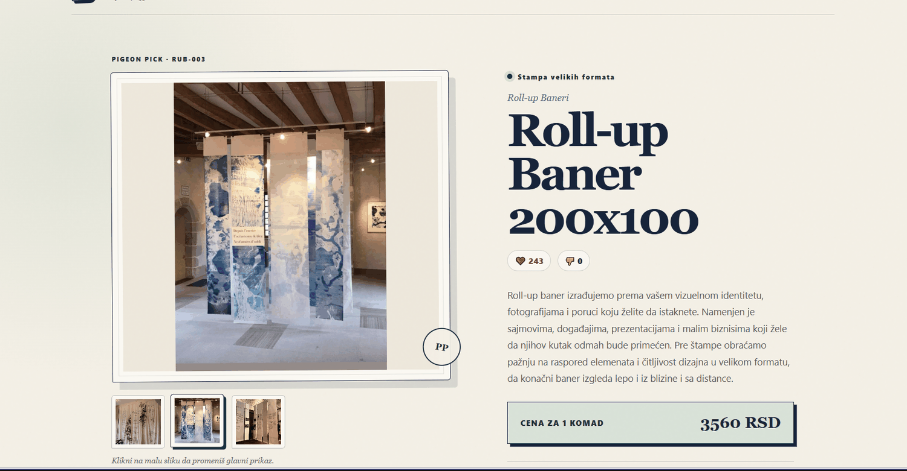
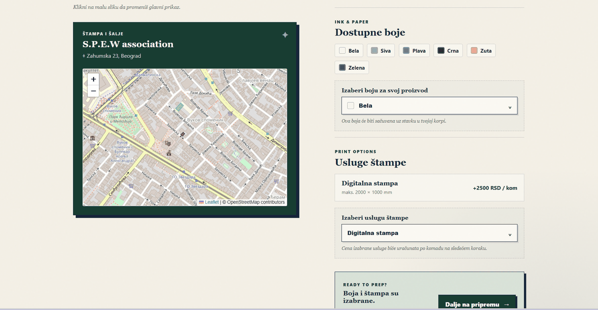
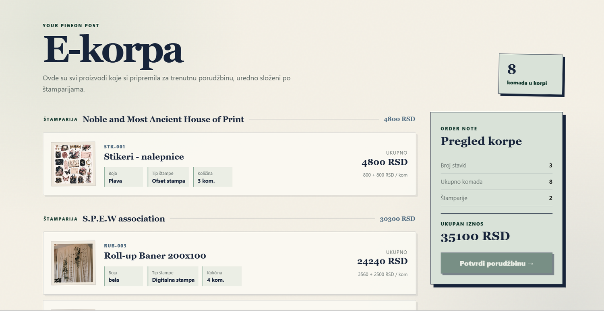
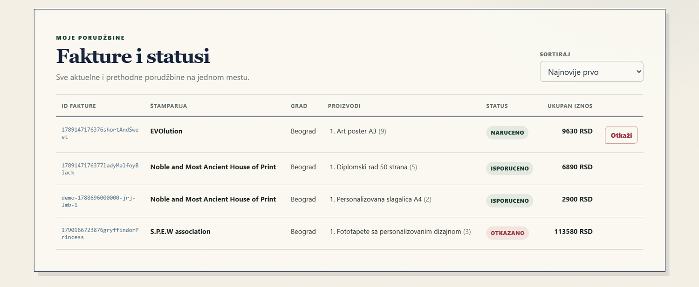
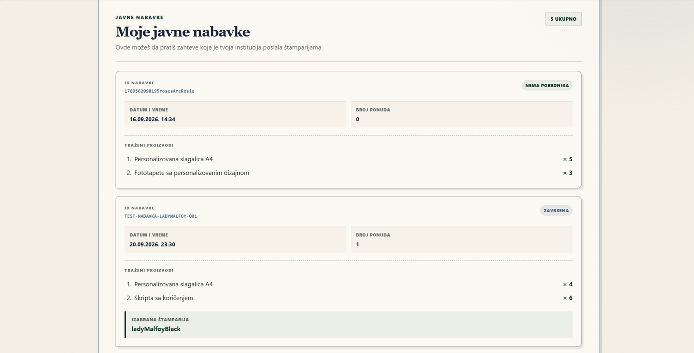
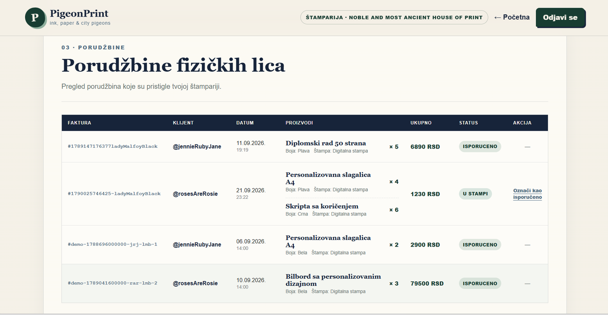
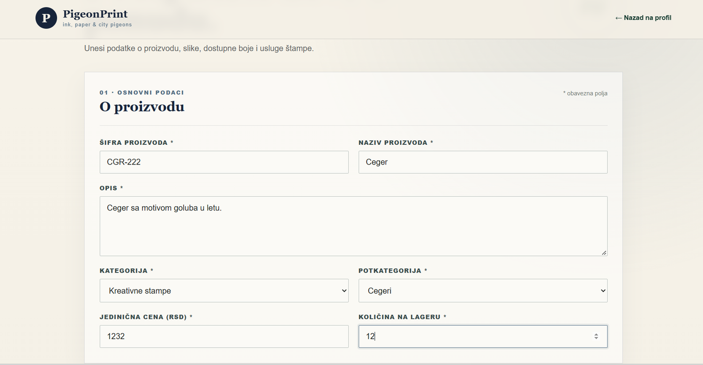
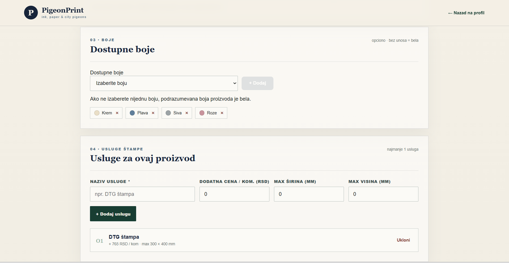
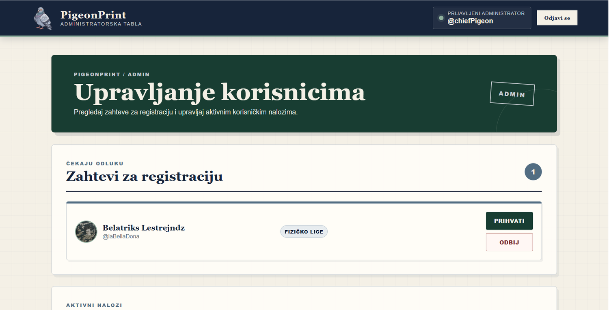

# PigeonPrint

A full-stack web platform for print shops, built with **Angular 20**, **Node.js/Express** and **MongoDB**. It connects three kinds of users: clients (individuals and companies), print shops, and an administrator.

> Built independently as a university project at the School of Electrical Engineering, University of Belgrade (ETF).

## Screenshots

### Clients and public pages

| Home: top 5 products | Catalogue with search, filter and sorting |
|---|---|
|  |  |

| Product details with gallery | Print shop map, colors and print services |
|---|---|
|  |  |

| Shopping cart grouped by print shop | Orders and statuses |
|---|---|
|  |  |

### Company clients



### Print shops

| Incoming orders and status flow | Add a new product |
|---|---|
|  |  |



### Administrator



## Features

### Authentication and registration
- Login with username and password; separate, non-public login route for the administrator
- Password reset via a temporary link (valid for 5 minutes)
- Registration for individual clients, companies and print shops, with client-side and server-side validation
- Password rules enforced with a regex; passwords stored hashed
- Profile picture upload with size and format checks (default picture if none is provided)
- Admin approval flow: new client and print shop accounts become active only after approval

### Public home page
- Overview with the number of registered print shops and the top 5 most liked products
- Product search by name and/or category, with sortable results
- Product details page with a thumbnail gallery

### Clients
- Profile management and a table of current and past orders, with sorting and order cancellation
- Product search and a detailed product page including the print shop's location on a map
- Product preparation page: add text or an image that is rendered over the product
- Shopping cart grouped by print shop, with stock checks
- Order history and product archive, with likes/dislikes and comments

### Company clients (procurement)
- Public procurement with bidding: a company opens a request, print shops submit offers, and the lowest valid offer wins
- Stock validation per product, and order/invoice creation for the winning bid

### Print shops
- Profile management
- Add products and print services, update stock quantities
- Manage incoming orders through the status flow (ordered, in print, delivered)
- Submit offers for open procurement requests

### Administrator
- View, update and delete user accounts
- Review registration requests
- Manage product categories and subcategories

### Other
- Responsive design
- Consistent look with shared CSS, header, footer and navigation on every page

## Tech stack

| Layer | Technologies |
|---|---|
| Frontend | Angular 20, TypeScript, HTML/CSS |
| Backend | Node.js, Express, REST API |
| Database | MongoDB |

## Getting started

### Prerequisites
- Node.js (LTS) and npm
- A running MongoDB instance (local or Atlas)

### 1. Clone the repository
```bash
git clone https://github.com/adriiance/pigeonPrint.git
cd pigeonPrint
```

### 2. Backend
```bash
cd backend
npm install
copy .env.example .env   # (macOS/Linux: cp .env.example .env), then fill in your own values
npm run build            # compiles TypeScript to dist/
npm start                # runs dist/server.js
```

### 3. Frontend
```bash
cd frontend
npm install
npm start                # or: ng serve
```
The app runs at `http://localhost:4200`.

### 4. Database
The collections are not created by the application. Import the sample data from the `mongo/` folder into a database called `pigeonPrint` (for example with MongoDB Compass, or `mongoimport`) before first use. The folder contains one JSON file per collection: users, products, categories, comments, invoices and public procurements. All data is fictional.

## Project structure
```
pigeonprint/
├── frontend/   # Angular application
├── backend/    # Express API, controllers, routes and MongoDB models (TypeScript)
└── mongo/      # Sample data, one JSON file per collection
```

## Author
**Adriana Vidić**: software engineering student at ETF and programming teacher.
[GitHub](https://github.com/adriiance)
